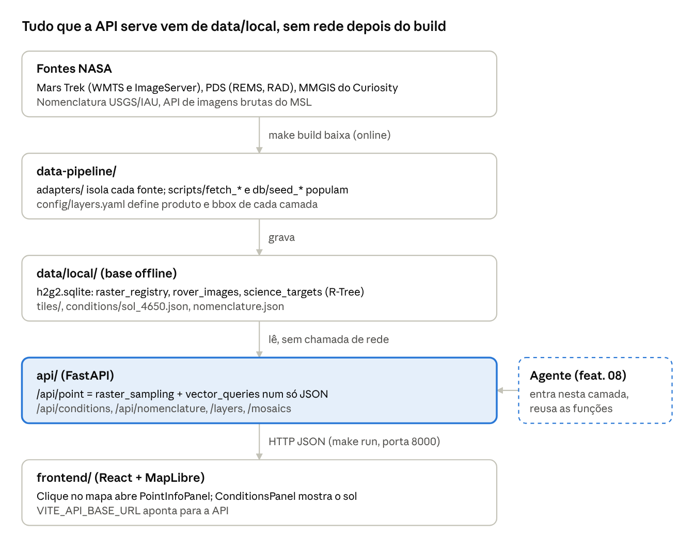
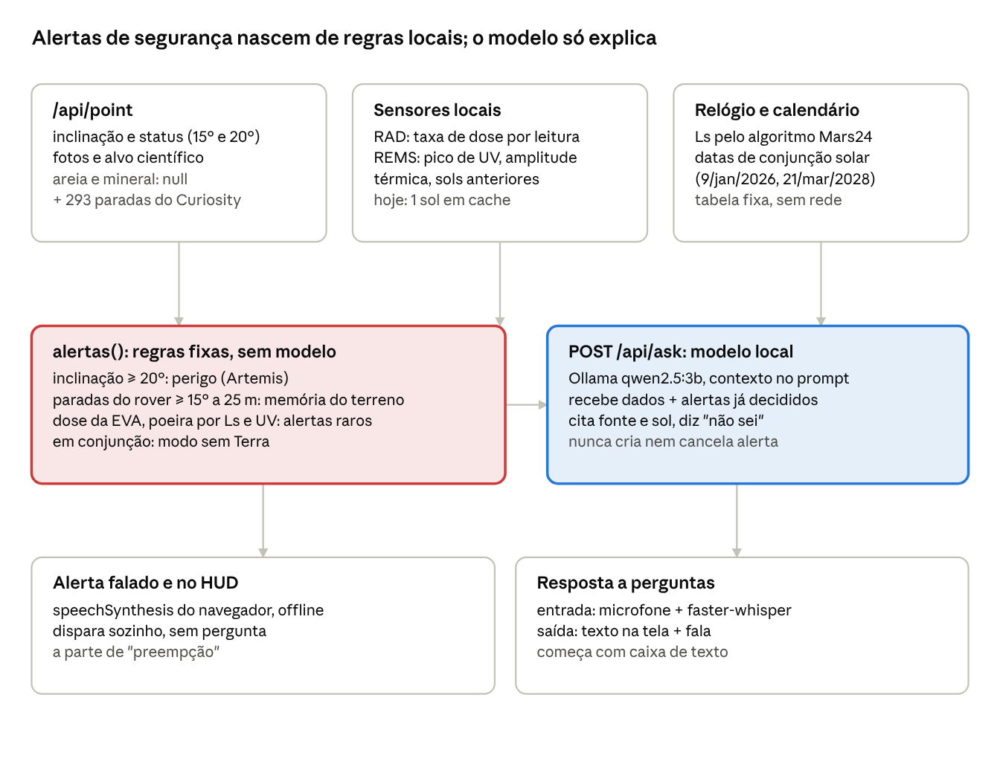

# Feature 08 · Agente local

13/11/2026 · Hugo · versão viva: [Claude Docs](https://claude.ai/artifact/K3TLaCQGkbj9KqXqvUVgWQ)

## Resumo

O agente local tem duas partes que precisam ficar separadas. Os **alertas proativos** são regras fixas sobre os dados que a API já devolve e não usam modelo de linguagem. A **resposta a perguntas** usa um modelo de linguagem local que só reformula o contexto do ponto e nunca decide nada.

Quase todo o insumo já existe: `/api/point`, `/api/conditions` e `/api/nomenclature` rodam 100% offline sobre `data/local/`. O que falta é a camada do agente (endpoint, prompt, regras e voz). O maior limite está no dado, não no código. O DTM de cerca de 5,9 m por pixel não enxerga as cristas: das 25 paradas em que o Curiosity mediu 15° ou mais, ele só marcou 4. Além disso, as colunas de areia e de mineral estão vazias e só há um sol de clima em cache.

O diferencial (o "coringa") é a **memória do terreno**: usar a inclinação que o próprio Curiosity mediu nas mesmas trilhas para avisar onde o mapa erra. Radiação e poeira continuam como alertas locais, mas ficam em segundo plano: são raras e, na superfície, a radiação quase nunca é aguda. "Sem Terra" não é uma exceção: numa EVA a Terra nunca está disponível em tempo real, e a rede de retransmissão está encolhendo. Recomendação: implementar nesta ordem: (1) alertas por regra com o histórico de terreno, (2) `POST /api/ask` com o contexto inteiro no prompt, (3) modo sem Terra, (4) voz. Não usar tool-calling, embeddings nem framework de agente: o contexto de um ponto cabe em cerca de 2 KB.

## O desafio e os recursos oficiais

O desafio não pede voz nem IA. Pede um mapa ou interface para uso durante a EVA, com pelo menos 3 tipos de dado, **segurança do astronauta em primeiro lugar** (radiação e mobilidade com traje) e uma rota que evite obstáculos. O HUD no visor é citado como formato possível. O agente só pontua se reforçar a segurança, e por isso os alertas vêm antes do chat.

A aba Resources lista 5 recursos da NASA e nenhum de agência parceira:

| Recurso | Serve ao agente? | Situação no repo |
| --- | --- | --- |
| [Mars Trek (JPL)](https://trek.nasa.gov/mars/) | Sim, é a fonte do relevo e das imagens | Já ingerido (CTX, HiRISE, DTM, MOLA, THEMIS) |
| [USGS-NASA Planetary Geologic Mapping](https://astrogeology-usgs.hub.arcgis.com/pages/interactive-maps-mars) | Sim, daria a unidade geológica do ponto | Não ingerido |
| [Rota proposta do Curiosity no Monte Sharp](https://science.nasa.gov/resource/curiositys-proposed-path-up-mount-sharp/) | Indireto, é uma referência visual de rota | É vídeo, não dado |
| [NASA Worldview](https://worldview.earthdata.nasa.gov/) | Não, são imagens da Terra | — |
| [Fotos brutas do Perseverance](https://mars.nasa.gov/mars2020/multimedia/raw-images/) | Não, são de Jezero (só serviria no plano B) | — |

Fonte: [página do desafio, aba Resources](https://www.spaceappschallenge.org/2026/challenges/interplanetary-survival-guide-martian-map/?tab=resources), publicada em 13/11/2026.

## Como o sistema funciona hoje

A rede só é usada no `make build`; a partir daí, tudo que a API serve sai de `data/local/`. Isso já entrega a premissa de "funcionar sem a Terra" que o agente precisa.

O `/api/point` (`api/main.py:46`) junta três consultas num JSON: fotos dentro de 200 m e o alvo científico mais próximo dentro de 500 m (`api/vector_queries.py`, filtro grosso pelo R-Tree do SQLite e depois a distância real) e a elevação com inclinação (`api/raster_sampling.py`, que abre o GeoTIFF e calcula a inclinação numa janela 3×3). As condições e a nomenclatura são JSONs lidos do disco (`api/conditions.py`, `api/nomenclature.py`).

## Os dados que o agente pode consumir

O agente pode usar 10 fontes com valor real hoje. Areia, mineral e vento estão vazios ou não existem. Os valores abaixo foram lidos do `data/local/` gerado pelo `make build`.

| Campo | Origem | Valor real / cobertura | Uso no agente |
| --- | --- | --- | --- |
| `raster_values.elevacao_m` | DTM HiRISE (`api/raster_sampling.py`) | -4031 a -3313 m no bbox | Responder "qual a altitude" |
| `raster_values.slope_deg` + `slope_status` | Diferença finita 3×3 no DTM | `seguro` < 15°, `atencao` ≥ 15°, `perigo` ≥ 20° | Alerta de mobilidade (resolução insuficiente, ver abaixo) |
| `raster_values.classe_ai4mars` | — | Sempre `null` (AI4Mars não cobre a época do boxwork) | Alerta de areia: **sem dado** |
| `raster_values.mineral_crism` | — | Sempre `null` (CRISM sem observação no bbox) | — |
| `nearby_photos[]` | `rover_images`, raio de 200 m | 200 fotos, sol 4560 a 4609, 9 câmeras | "Tem foto daqui?" com distância e direção |
| `science_target` | `science_targets`, raio de 500 m | 3 alvos (Cristas de boxwork, Altadena #43, Totoral/Sillar) | "O que é isto?" com fonte e confiança |
| `rems` | `data/local/conditions/sol_4650.json` | Temperatura -78,7 a -8,1 °C, 693,8 Pa, UV pico 6,04 W/m², umidade 7,1% | Condições do sol |
| `rad` | mesmo arquivo | 6,53 µGy/h (156,8 µGy/dia) | Orçamento de dose |
| `/api/nomenclature` | `data/local/nomenclature.json` | 13 feições IAU (ex.: Aeolis Mons, Aeolis Palus) | Nomear o lugar |
| **Paradas do Curiosity** | `data/local/rover_waypoints.json` (MMGIS) | 293 paradas no bbox, sols 3951 a 5070, com inclinação medida (`tilt`) | **Memória do terreno** (o coringa) |

Lacunas que afetam o agente:

- **Um único sol de clima (4650).** "Como está hoje?" sempre responde com o sol 4650. O agente precisa dizer de qual sol é o dado.
- **Não existe vento nem opacidade de poeira.** A pergunta de exemplo da proposta ("como está a poeira hoje?") hoje só pode ter "não sei" como resposta honesta.
- **Não existe rota.** "Inclinação do próximo trecho" depende da feature 02; até lá, o agente só responde sobre o ponto atual.

## Regras que o agente herda do código atual

O agente não deve redefinir nenhuma destas regras: deve ler o resultado delas. Se um limiar mudar, muda em um lugar só.

- **Limites de inclinação:** 15° vira `atencao` e 20° vira `perigo` (o limite de caminhada do Artemis). As constantes ficam em `api/raster_sampling.py` (`LIMITE_SLOPE_ATENCAO_DEG`, `LIMITE_SLOPE_PERIGO_DEG`). O frontend repete o rótulo "20°" em `frontend/src/theme/verdict.ts`.
- **Prioridade da elevação:** quando o DTM e o MOLA cobrem o ponto, vale o DTM. Se nenhum cobre, elevação e inclinação ficam `null`, e o agente precisa tratar `null` como "sem dado", nunca como zero.
- **Fora do bbox:** fora de 137,3586 a 137,4094 de longitude e -4,8263 a -4,7757 de latitude não existe raster nenhum. O ponto devolve tudo `null` sem erro HTTP.
- **Fotos:** só até 200 m, ordenadas por distância. A posição é de onde a foto foi tirada, não do que ela mostra, e a proposta pede que a interface diga isso.
- **Alvo científico:** só o mais próximo, até 500 m. Cada alvo tem `confianca` e `fonte`, que devem ir para a resposta.
- **Distância:** haversine com o raio de Marte (3.396.190 m), em `api/geo.py`. Não reaproveitar a conversão pixel/grau do Mars Trek.
- **Condições:** amarradas ao sol, não à coordenada. Sol sem cache devolve 404 com a instrução de qual script rodar.

## Arquitetura proposta

Todo alerta de segurança sai de uma função de regras fixas. O modelo de linguagem recebe esses alertas já decididos e só os explica em linguagem natural. Assim um modelo de 3B que erra nunca esconde nem inventa um perigo.

As entradas funcionam sem rede: o ponto e as paradas do rover vêm do disco, os sensores vêm do cache do REMS e do RAD, e o calendário é cálculo puro (Ls) mais uma tabela de datas de conjunção. Não há tool-calling nem embeddings: o contexto inteiro de um ponto cabe no prompt.

## O coringa: memória do terreno

O Curiosity percorreu o boxwork e registrou a inclinação real em cada parada. Esse histórico mostra, com dado medido no chão, onde o mapa de relevo erra. O terreno é o risco que acontece de fato numa EVA, ao contrário das tempestades.

| | Inclinação medida pelo rover | Inclinação do nosso DTM no mesmo ponto |
| --- | --- | --- |
| Paradas no bbox | 293 (sols 3951 a 5070) | 292 com valor |
| Mediana | 8,6° | 8,1° |
| Paradas com 15° ou mais | **25** | **4** dessas 25 |
| Pior ponto (sol 4970) | **24,0°**, acima do limite do Artemis | 15,4° |
| Sol 4309 | 22,4° | 11,0° |

Os relatos da própria missão confirmam o padrão. Uma subida de 12 m saindo de uma depressão passou de 20° e [o rover patinou](https://science.nasa.gov/blog/curiosity-blog-sols-4614-4615-driving-along-the-boxwork/). As cristas [quase não são mais largas que o rover](https://science.nasa.gov/blog/curiosity-blog-sols-4641-4648-thinking-outside-and-inside-the-boxwork/), por isso nenhum mapa com cerca de 6 m por pixel consegue enxergá-las.

**Como entra no agente:** uma regra a mais na função `alertas`. Para cada ponto da rota, procurar paradas do rover num raio de cerca de 25 m com inclinação de 15° ou mais e devolver a frase com sol e distância ("o Curiosity mediu 22° a 8 m daqui, no sol 4309"). São 293 pontos, então uma varredura simples resolve, sem índice espacial. O dado já está baixado. Os relatos da missão entram depois como pontos manuais, no mesmo padrão de `seed_science_targets.py`.

**Limites que precisam ser ditos no pitch:**

- **Viés de sobrevivência:** o rover evitou os piores trechos. "Nada aconteceu aqui" não quer dizer "seguro".
- **Rover não é humano:** a areia funda que prende 900 kg não prende quem anda a pé, e uma crista de 1,5 m que o rover contorna a pessoa sobe. A inclinação do rover inclui o apoio das rodas em pedras, na escala de cerca de 3 m.
- **Só vale onde o rover passou.** Fora do caminho dele, o agente depende só do DTM.
- A frase certa é "aqui já aconteceu isto", nunca "aqui vai acontecer".

## Perigos naturais e comunicação

Radiação e poeira continuam no agente, mas como alertas raros e secundários. A parte forte desta seção é o argumento da comunicação: um sistema que depende da Terra se apoia numa rede que está encolhendo.

### "Sem Terra" é o estado normal

- **Durante a EVA:** o atraso de ida varia de 0 a 22 minutos, e a NASA pede autonomia da tripulação acima de 5 min. O contato só existe nas passagens dos orbitadores. Na prática, uma EVA nunca tem a Terra em tempo real.
- **Conjunção solar:** acontece a cada cerca de 26 meses (não todo ano) e dura cerca de 2 semanas. A última foi em 9/jan/2026 e a próxima é em **21/mar/2028**. A pausa de 2024 foi de 11 a 25/nov. O estudo ASCEND estima que, conforme a banda de rádio, a interrupção pode ir de dias a meses.
- **A rede de retransmissão está encolhendo:**
    - O MAVEN perdeu contato em 6/dez/2025 e foi [declarado perdido em 3/jun/2026](https://www.sciencenews.org/article/nasa-maven-mars-atmosphere-dead).
    - O Odyssey usa só 0 a 1 passagem por dia para retransmissão.
    - Os orbitadores que restam têm de 10 a 25 anos.
    - A nova rede (MTN, US$ 700 milhões) só tem o primeiro orbitador [pronto para lançar no fim de 2028, no mínimo](https://orbitaltoday.com/2026/03/03/rocket-lab-proposes-mars-telecommunications-orbiter-for-nasas-700m-mtn-mission/), depois da conjunção de mar/2028.
- **Na conjunção, a Terra também não vê o perigo.** A face do Sol voltada para Marte fica oculta para a Terra. Só o [Solar Orbiter observa essa face, e só às vezes](https://arxiv.org/pdf/2404.06794). Isso é uma dedução nossa pela geometria; não achamos um artigo que afirme isso para Marte.

### Perigos naturais e como detectá-los sem a Terra

| Perigo | O que a pesquisa diz | Sinal local | Dado no repo | Regra proposta |
| --- | --- | --- | --- | --- |
| Tempestade de partículas solares (SPE) | Na superfície, a atmosfera filtra a maior parte. O dia normal tem cerca de [0,64 mSv](https://www.scientificamerican.com/article/radiation-on-mars-managea/). O maior evento medido (20/mai/2024) deu cerca de 8.100 µGy, segundo a NASA cerca de 8 vezes um dia normal. Só cenários extremos e raros chegam a níveis perigosos ([Zhang et al. 2023](https://agupubs.onlinelibrary.wiley.com/doi/10.1029/2023SW003490)). São cerca de 16 eventos na superfície em cerca de 13 anos. | Taxa de dose do RAD. O *nowcasting* de Löwe et al. (2025) dispara com dose 25% acima da linha de base e dá 30 min ou mais de aviso. | RAD de um único sol (4650), com 87 leituras | **Orçamento de dose da EVA** ("esta EVA acumulou X"). A regra dos 25% fica como reforço raro: "abrigo recomendado", não sirene. A chance de uma EVA de 6 h coincidir com um evento é menor que 1% (cerca de 1,2 eventos por ano, cada um de horas a dias). |
| Tempestade de poeira | As tempestades globais começaram sempre entre Ls 185° e 300°. Em 2018 a opacidade em Gale foi de 0,6 a 8,5 em 12 sols, o pico de UV caiu 90% em 10 sols e a amplitude térmica do ar diminuiu 56 K. A tempestade de 2018 nasceu de uma precursora vista dias antes nos [mapas diários do MARCI](https://astrogeology.usgs.gov/search/map/mars_mro_marci_daily_global_weather_maps_pds4_archive). | Estação (Ls pelo algoritmo Mars24) e queda de UV e da amplitude térmica do REMS | REMS de um sol (UV pico 6,04, -78,7 a -8,1 °C) | Ls entre 180° e 330°: "temporada de poeira". Pico de UV mais de 50% abaixo da média de 7 sols: "possível tempestade, revisar a EVA". O limiar de 50% é escolha nossa. Histórico de tempestades perto de Gale via MARCI (anos marcianos 28 a 34): pitch, e implementação só se sobrar tempo. |
| Martemoto | O maior registrado pela InSight foi de magnitude 4,7 (4/mai/2022). Num terremoto equivalente na Terra, janelas quebram mas casas não caem. Não há previsão possível. | Nenhum disponível | — | **Fora do escopo.** O agente só cita quando for perguntado. |
| Redemoinho de poeira | Frequentes (observados pela Viking, Pathfinder e MGS). A preocupação é o vento e a poeira em óticas e pulmões. | Vento e pressão do REMS (o sensor de vento do Curiosity tem dados limitados) | Não há | **Fora do escopo** no MVP. |

### Ideia descartada: o orbitador avisar a superfície

O instrumento de partículas do MAVEN media só até 6 MeV, e a dose na superfície vem de partículas acima de cerca de 150 MeV. Já houve evento forte visto em órbita [sem sinal no chão](https://ui.adsabs.harvard.edu/abs/2016AGUFM.P13A1880L/abstract). Além disso, o MAVEN não opera mais.

## Pontos de atenção

O risco mais sério é o alerta de inclinação: hoje ele não enxerga as cristas do boxwork, e agora temos a medição do rover para provar. Os outros itens são ajustes pequenos, mas que bloqueiam ou enganam o agente.

**Confirmado (medido ou lido no código):**

1. **O "DTM 1 m" está com cerca de 5,9 m por pixel.** O arquivo `dem_512x512.tif` cobre cerca de 3 km em 512 pixels (9,92×10⁻⁵ graus por pixel). A janela 3×3 de `_slope_degrees` mede a inclinação numa base de cerca de 12 m, e as cristas de 1 a 2 m somem na média. **Comparado com as paradas do Curiosity, o DTM marcou só 4 dos 25 pontos com 15° ou mais.** Correção: baixar o recorte em resolução nativa (`tile_matrix` maior em `fetch_dtm_test.py`) e usar as paradas do rover como teste de validação.
2. **O CORS só libera GET** (`api/main.py`, `allow_methods=["GET"]`). Um `POST /api/ask` vindo do frontend vai ser bloqueado no preflight. É preciso adicionar POST.
3. **A areia, que é o risco citado pela própria proposta, não tem dado** (`classe_ai4mars` sempre `null`). O agente nunca pode dizer "sem areia", só "sem dado de areia".
4. **Nenhum limiar de radiação existe no repo.** Os 156,8 µGy/dia são dose absorvida (Gy). Limites de carreira são dose equivalente (Sv), e converter exige um fator de qualidade que o projeto não tem. As duas unidades não podem ser comparadas diretamente.
5. **A amostragem lê o raster inteiro a cada chamada** (`dataset.read(1)[row, col]` em `sample_point`). Com 512² pixels isso não pesa para o agente, mas pesa se alertas ou A* chamarem ponto a ponto ao longo de uma rota.
6. **O sol de referência está fixo em 4650** (`REFERENCE_SOL`), enquanto as fotos vão de 4560 a 4609. A resposta precisa citar o sol de cada dado para não misturar épocas.

**Suspeita, a confirmar:**

- O DTM não declara `nodata` (`None`). Se houver buracos com valor sentinela, eles virariam inclinações absurdas. Não vi nenhum no recorte atual (mínimo de -4031 m).

## Plano de implementação

São seis etapas, cada uma demonstrável sozinha. Se o tempo acabar, o que já está pronto continua de pé.

- [ ] **1. Alertas por regra + memória do terreno** — uma função `alertas(point, conditions)` em `api/` que lê `slope_status`, os campos `null`, o sol do dado e as paradas do rover num raio de cerca de 25 m. Devolve frases prontas com a fonte. Vira um campo `alertas` no `/api/point`, um acréscimo que não quebra a feature 02. Deixar um teste com `assert` para 15°, 20°, `null` e o ponto do sol 4309.
- [ ] **2. `POST /api/ask`** — recebe pergunta, lat, lon e sol; monta o contexto com as funções existentes mais os alertas; chama o Ollama (`qwen2.5:3b`) via `urllib`. Liberar POST no CORS. Teste: uma pergunta fora do contexto tem que responder "não sei".
- [ ] **3. Modo sem Terra** — tabela de conjunções, idade de cada dado na resposta, Ls pela fórmula do Mars24 (biblioteca padrão), regra de poeira, orçamento de dose e regra dos 25% de Löwe et al. Para ter linha de base, o `cache_conditions.py` passa a guardar vários sols.
- [ ] **4. Voz** — a fala de saída usa `speechSynthesis`. A entrada usa `MediaRecorder` mais `faster-whisper` (modelo `base`). Começar com uma caixa de texto.
- [ ] **5. Corrigir a inclinação** — baixar o DTM em resolução nativa e medir de novo contra as 25 paradas do rover com 15° ou mais.
- [ ] **6. Demo de radiação (opcional)** — reproduzir o evento de 20/mai/2024 com as leituras do RAD. Antes, confirmar o número do sol e se ele já está publicado no PDS.

**Decisões em aberto:**

- "Preempção" significa os alertas proativos (etapa 1)? Este documento assume que sim.
- Raio de 25 m e limiar de 15° na memória do terreno, 50% de queda de UV e a linha de base de radiação: todos são escolhas nossas e precisam aparecer como tal no pitch.
- O modelo cabe no hardware da demo? Num i5-8600 sem GPU, espera-se cerca de 10 tokens/s com um modelo de 3B. Isso é uma estimativa ainda não medida.
- Gravação de vídeo de backup, como a proposta recomenda para o risco de travar ao vivo.

## Fontes

Resultados de busca consultados em 13/11/2026. As datas e os números devem ser conferidos na fonte primária antes de entrarem no pitch.

- [JPL: What's Mars Solar Conjunction, and Why Does It Matter?](https://www.jpl.nasa.gov/news/whats-mars-solar-conjunction-and-why-does-it-matter/)
- [JPL: NASA's Mars Fleet Lies Low With Sun Between Earth and Red Planet](https://www.jpl.nasa.gov/news/nasas-mars-fleet-lies-low-with-sun-between-earth-and-red-planet/)
- [Mars Society: Mars Solar Conjunctions and the Need for Resilient Communications (nov/2026)](https://www.marssociety.org/news/2026/11/10/mars-solar-conjunctions-and-the-need-for-resilient-communications-systems-between-mars-earth-blog/)
- [ALPO: The 2026-2027 Apparition of Mars](https://www.alpo-astronomy.org/jbeish/2027_MARS.htm)
- [NASA ASCEND: Communication Delays, Disruptions, and Blackouts for Crewed Mars Missions](https://ntrs.nasa.gov/citations/20220013418)
- [NASA: Lagrange-Based Options for Relay Satellites During Solar Conjunctions](https://ntrs.nasa.gov/citations/20205007788)
- [NASA TM-2025-003885: Assessment of the State of Communication Delay](https://ntrs.nasa.gov/api/citations/20250003885/downloads/NASA%20TM20250003885.pdf)
- [Science News: NASA declares MAVEN dead](https://www.sciencenews.org/article/nasa-maven-mars-atmosphere-dead)
- [Orbital Today: Mars Telecommunications Orbiter, missão MTN de US$ 700 milhões](https://orbitaltoday.com/2026/03/03/rocket-lab-proposes-mars-telecommunications-orbiter-for-nasas-700m-mtn-mission/)
- [Solar Orbiter: impacto das estruturas da face oculta do Sol](https://arxiv.org/pdf/2404.06794)
- [Löwe et al. 2025: Nowcasting Solar Energetic Particle Events for Mars Missions](https://arxiv.org/abs/2502.02469)
- [Space.com: Solar storm douses Mars in radiation (mai/2024)](https://www.space.com/mars-aurora-radiation-solar-storm-curiosity-rover)
- [Scientific American: Radiation on Mars "Manageable"](https://www.scientificamerican.com/article/radiation-on-mars-managea/)
- [Zhang et al. 2023: Radiation Impact of Extreme SEP Events on Mars](https://agupubs.onlinelibrary.wiley.com/doi/10.1029/2023SW003490)
- [MAVEN e MSL/RAD: eventos SEP observados em órbita](https://ui.adsabs.harvard.edu/abs/2016AGUFM.P13A1880L/abstract)
- [Guzewich et al. 2019: MSL Observations of the 2018 Global Dust Storm](https://agupubs.onlinelibrary.wiley.com/doi/10.1029/2018GL080839)
- [Viúdez-Moreiras et al. 2019: Effects of the 2018 Global Dust Storm as Measured by REMS](https://pmc.ncbi.nlm.nih.gov/articles/PMC6750032/)
- [Sánchez-Lavega et al. 2019: Onset and Growth of the 2018 Global Dust Storm](https://agupubs.onlinelibrary.wiley.com/doi/full/10.1029/2019GL083207)
- [Shirley et al. 2020: Orbit-Spin Coupling and the 2018 Dust Storm](https://agupubs.onlinelibrary.wiley.com/doi/full/10.1029/2019JE006077)
- [USGS: MRO MARCI Daily Global Weather Maps](https://astrogeology.usgs.gov/search/map/mars_mro_marci_daily_global_weather_maps_pds4_archive)
- [Atividade de tempestades de poeira perto dos locais candidatos do Mars 2020 (MARCI, anos 28 a 34)](https://www.sciencedirect.com/science/article/pii/S0019103518301106)
- [Curiosity Blog, Sols 4614-4615: Driving Along the Boxwork](https://science.nasa.gov/blog/curiosity-blog-sols-4614-4615-driving-along-the-boxwork/)
- [Curiosity Blog, Sols 4641-4648: Thinking Outside and Inside the Boxwork](https://science.nasa.gov/blog/curiosity-blog-sols-4641-4648-thinking-outside-and-inside-the-boxwork/)
- [SETI: The most powerful marsquake ever detected](https://www.seti.org/big-one-most-powerful-marsquake-ever-detected)
- [National Academies: Safe on Mars](https://www.nationalacademies.org/read/10360/chapter/5)
- [Mars24: Technical Notes on Mars Solar Time](https://oregonl5.nss.org/mist/docs/Mars24J/help/notes.html)
